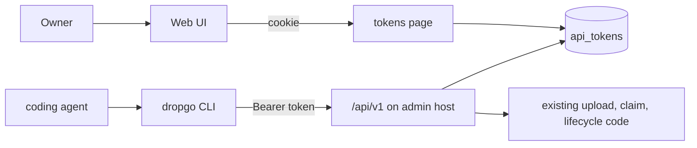

## Context

dropgo serves an admin host and a share host from one binary. Today the owner can only act through the admin host's Web UI:

- Sign-in is OIDC in a browser, and the result is a cookie session.
- `/api/check` and `/api/upload` already answer in JSON, with localized error messages.
- Edit, delete, restore and purge are HTML forms that answer with a redirect.
- Any request other than GET, HEAD or OPTIONS needs an `Origin` that matches the admin origin.



## Goals / Non-Goals

Goals:

- An agent can do everything the Web UI does except purge and preferences. That covers check, upload, list, get, edit, trash, restore, and reading files.
- Every result and every error is JSON with a stable `code`.
- One install prompt works in any coding agent.

Non-goals:

- OAuth device flow or a browser login from the CLI.
- Token scopes. Every token can do everything the API allows.
- An MCP server.
- Release binaries for platforms other than linux-amd64.
- Bearer tokens on the share host.

## Decisions

### Tokens

A token is `dgo_` followed by 32 random bytes in base64url. The prefix lets secret scanners and the owner recognize it. The `api_tokens` table holds:

- `id`, `user_id`, `name`
- `prefix`: the first 8 characters after `dgo_`, shown in the list
- `hash`: SHA-256 of the whole token
- `created_at`, `expires_at`, `last_used_at`

A plain SHA-256 is enough because the token has 256 bits of entropy. Revoking deletes the row.

Each API request checks that the token's user still has an owner claim in `DROPGO_OWNERS`. Without that check, removing a name from the allowlist would leave its tokens working for up to their full expiry. The MVP promises that a removal takes effect within 12 hours. The claim comes from a new `users.owner_claim` column, written on every sign-in where `find_or_create_user` already runs. Users who have not signed in since the deploy have no claim, so the tokens page asks them to sign in again before creating a token. The session format does not change.

The tokens page answers with `Cache-Control: no-store`, so the page that shows a new token is never cached. The create POST renders that page directly. Storing the plaintext in the session for a redirect would put the token in the sessions table. A browser resubmit would create a second token, which then shows up in the list and can be revoked. Every token query filters by `user_id`.

The expiry choices are 7, 30, 90 and 365 days, with 90 as the default. There is no "never".

Rejected:

- argon2 for the hash. It exists for low-entropy passwords and would add about 50 ms to every API call.
- Soft delete on revoke. Nothing reads a revoked token.

### The API

All routes live under `/api/v1` on the admin host:

| Method and path | Does |
| --- | --- |
| `GET /api/v1/me` | Returns the token's name and its expiry |
| `GET /api/v1/check?path=` | Same check as the Web UI |
| `POST /api/v1/shares` | Uploads. The multipart fields match `/api/upload`, settings before files. Answers 201 with the share |
| `GET /api/v1/shares?state=active\|trash&path=` | Lists shares, newest first, optionally at one path |
| `GET /api/v1/shares/{id}` | Returns one share in any state |
| `PATCH /api/v1/shares/{id}` | Edits path, visibility, password or expiry. JSON body |
| `POST /api/v1/shares/{id}/trash` | Moves a share to the trash |
| `POST /api/v1/shares/{id}/restore` | Restores a share. Optional JSON `{"path"}` |
| `GET /api/v1/shares/{id}/files` | Lists the files: relative path and size |
| `GET /api/v1/shares/{id}/files/{*rel}` | Returns the raw bytes. `?rendered=1` returns the rendered HTML of a Markdown file |

A share object holds:

- `id`, `path`, `url`, `state`, `visibility`, `entry`
- `file_count`, `size_bytes`
- `created_at`, `expires_at`, `trashed_at`, `purge_at`

Times are RFC 3339 in UTC. The object never holds the password hash.

`PATCH` applies only the fields that are present:

- `"expires_at": null` means never expires.
- `visibility: "public"` or `visibility: "owner"` clears the password.
- `visibility: "password"` needs a password unless the share already has one.
- A `password` with any other resulting visibility fails with `form.password_unused`.
- An `expires_at` in the past fails, as it does in the Web UI.

The Web UI's form instead turns public plus a password into a password share. The API skips that rule so that what the agent sends is what it gets. The handler reads the current row, fills in the fields that are absent, runs the `password_unused` check, sets `clear_password` for public and owner, and then calls `admin::save_edit`. Edit logic therefore lives in one place.

The upload route reuses `upload::upload` unchanged, apart from the JSON error shape and a 201 with the share object. The route gets the same `DefaultBodyLimit` as `/api/upload`. `visibility` stays required, as in the Web UI. `receive` runs the path precheck when it reads the first file field, so a `path` sent after a file used to be ignored without an error. It now rejects any settings field after a file with `upload.field_order`, on both upload routes. The Web UI already sends settings first.

Trash is idempotent: trashing a trashed share returns it unchanged, so an agent can retry after a network error. Restore looks up the share first, so it can tell 404 `share.not_found` from 409 `share.not_trashed`. `lifecycle::restore` answers `NotFound` for both cases.

File responses carry the share host's `SANDBOX` CSP, `nosniff` and `Content-Disposition: attachment`. The `/api/v1` router sits outside the admin `headers` middleware, because that middleware would overwrite the sandbox CSP with the admin one. The bearer requirement already keeps browsers from opening them. The headers keep the MVP rule that uploaded content never runs on the admin origin.

`/api/v1` takes bearer tokens only and never reads the session cookie. That lets the `Origin` check skip `/api/v1`: without a cookie there is nothing for a cross-site request to borrow. A missing, unknown or expired token gets 401. The handlers call the same code as the Web UI: `upload::upload`, `admin::save_edit`, `lifecycle::delete` and `restore`. Both paths therefore apply the same rules.

There is no purge route. The share host and its routes do not change. The `/api/v1` router has a JSON fallback for unknown routes and wrong methods. Its extractors map their rejections, such as bad ids, bad JSON and bodies over the limit, to the error shape.

Rejected: putting share paths in URLs, as in `/api/v1/shares/by-path/{*path}`. A path holds slashes and would collide with `/files`. The CLI resolves a path to an id instead.

### Errors

Every error body has this shape:

```json
{"error": {"code": "path.exists", "message": "…", "details": {}}}
```

- `code` is a catalog key, such as `upload.too_big` or `path.conflict`.
- `message` is always the English catalog text.
- `details` holds `existing` for `path.exists` and `arg` for keys that take an argument.

New catalog keys, in both `en` and `zh-TW` so the catalog test keeps passing:

- `auth.missing_token`, `auth.invalid_token`, `auth.token_expired`
- `api.not_found`, `api.bad_request`
- `share.not_found`, `share.not_trashed`, `file.not_found`
- `upload.field_order`, `form.password_unused`

The CLI's own codes (`config.missing`, `config.insecure_url`, `network`, `bad_input`, `ref.ambiguous`) are not catalog keys. They never come from the server.

The Web UI's `/api/upload` and `/api/check` keep their current localized shape.

### CLI

The CLI is a set of clap subcommands in the same binary.

- Running `dropgo` with no subcommand still serves, so the Docker image and its `ENTRYPOINT` do not change.
- `serve` and `rerender` take the server `Config`. Client commands do not, so they run without any server env.

The commands are:

- `auth login`, `auth status`
- `check <path>`
- `upload <file|dir|zip|->`, with `--name` for stdin, and `--path`, `--visibility`, `--password`, `--expires never|1d|7d|30d|<RFC 3339>`, `--replace`
- `list [--trash]`, `get <ref>`
- `edit <ref>`, with `--path`, `--visibility`, `--password`, `--expires`
- `trash <ref>`, `restore <ref> [--path]`
- `cat <ref> [file] [--rendered]`

A `<ref>` is a share id or a share path:

- A UUID is always an id. A valid path can look like a UUID, and such a path still resolves by id.
- Otherwise the CLI calls `GET /api/v1/shares?path=`. The server normalizes the path.
- `restore` searches the trash. Several trashed shares can share a path, and then the CLI fails with `ref.ambiguous` and lists them.

A directory upload runs `ignore_rules::kept_files` on the client before sending. That is the same function the server uses. This keeps `node_modules` off the wire and under the 10,000 file limit, and the server runs the rules again anyway.

The CLI fills in the upload settings:

- A new share with no `--visibility` is sent as `owner`, as the MVP requires.
- `--replace` calls `check` first. When the answer is `path.exists`, the CLI sends `overwrite=<existing id>`, and any visibility or expiry the user did not give comes from `details.existing`. An empty password already keeps the old one on the server. Without this, `--replace` could turn a private share public.
- `--password` with a resulting visibility other than `password` fails locally with `bad_input`. Otherwise the server would drop the password and the share would stay open.

The files go over the wire once. A `PATCH` between the check and the upload could still be overwritten. With one owner that window is accepted.

The CLI refuses an `http://` URL unless the host is local, so a token never crosses the network in clear text.

Output rules:

- stdout gets one JSON value per command.
- `cat` with a file writes the raw bytes, because the bytes are what the caller asked for.
- Errors go to stderr as the API's error JSON. Client-side failures (`config.missing`, `network`, `bad_input`) use the same shape.

| Exit | Meaning |
| --- | --- |
| 0 | Success |
| 2 | Bad arguments (clap) |
| 3 | Not signed in, or the token is invalid or expired |
| 4 | Share or file not found |
| 5 | Conflict: path taken, path changed, or the share is not in the trash |
| 6 | Input rejected: bad path, too big, no entry file, and so on |
| 7 | Network failure or server error |

Config resolution:

1. `DROPGO_URL` and `DROPGO_TOKEN` env vars override the file.
2. Otherwise `$XDG_CONFIG_HOME/dropgo/config.toml`, which falls back to `~/.config/dropgo/config.toml`.

The file is written with mode 0600.

`auth login` behaves differently depending on whether stdin is a terminal:

- On a terminal it asks for the URL unless `--url` is given, then reads the token without echo. It uses the `rpassword` crate for that.
- Off a terminal it needs `--url` and reads the token from stdin.

Either way it calls `/api/v1/me` and saves only after that succeeds.

The HTTP client is `reqwest` 0.12 with the `multipart`, `stream` and `rustls-tls` features. The tree already has that version through `openidconnect`, so it adds no new major version.

Rejected:

- A separate `dropgo-cli` crate. It means a second crate and a second release path, only to save binary size.
- Human-readable output. Agents are the audience, and a human can pipe the JSON to `jq`.

### Skill, install prompt, release binary

`skills/dropgo/SKILL.md` follows the common Agent Skills format: frontmatter with `name` and `description`, then the body. The body tells an agent:

- when to use dropgo
- that it must never ask the user to paste a token into the chat
- how to run `dropgo auth status`
- the command list and the exit-code table

The release job publishes two assets:

- `dropgo-linux-amd64`, copied out of the image it just pushed with `docker create` and `docker cp`
- `SKILL.md`

Rejected: a SHA-256 file in the same release. It cannot catch a tampered release, and HTTPS plus `dropgo --version` already catch a broken download.

The README prompt fetches both from `releases/latest/download/`, so the skill always matches the binary and the prompt never needs editing. The prompt tells the agent to:

1. Install the binary into a directory on `PATH`. On other platforms, use `cargo install --git … --tag <latest>`.
2. Put `SKILL.md` where that agent loads user-level skills. If the agent has no skill support, append a short section to its global instructions file instead.
3. Run `dropgo --version` to confirm the install.
4. Ask the user to run `dropgo auth login` in their own terminal.

Rejected: a skill under `.claude/skills/`. That directory holds the skills for developing dropgo, not for using it.

### Tokens page

The admin host gets `/tokens`, a nav entry next to Shares. It shows:

- the list: name, prefix, created, expires, last used, and an expired badge
- a form with a name and an expiry select
- after creating, the new token once, with a copy button

Revoking is `POST /tokens/{id}/revoke`. The page uses the same layout, CSP and i18n as the other admin pages.

## Risks / Trade-offs

- [A token leaks] → It expires within the chosen expiry, the owner can revoke it at once, and `last_used_at` shows whether it is being used.
- [An agent trashes the wrong share] → The trash keeps it for 30 days, and the API has no purge route.
- [The release binary drifts from the image] → Both come from the same build, because the binary is copied out of the image.

## Migration Plan

- Migration `0002_api_tokens.sql` adds the table and the nullable `users.owner_claim` column. Rolling back means dropping both.
- Users get their claim on their next sign-in. Until then only the tokens page notices, and it asks for a fresh sign-in.
- The homelab needs only the new image tag.
