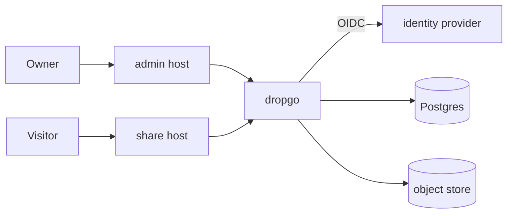
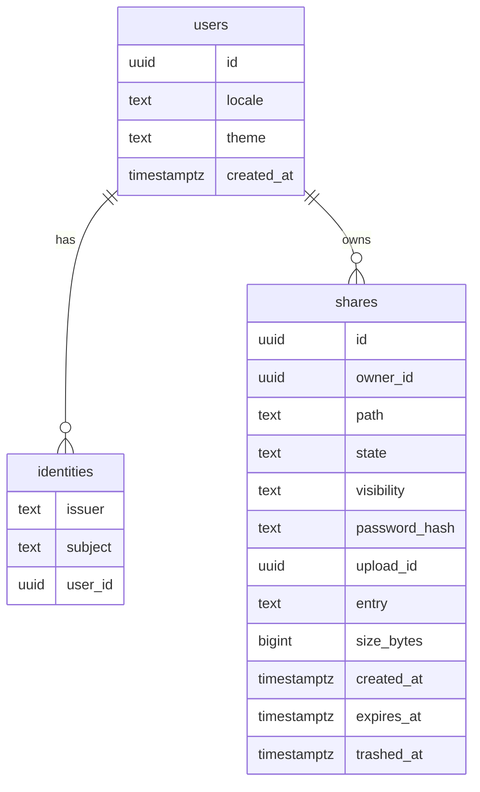

## Context

This is a new repo. One Rust binary serves two hostnames:

- The admin host (`drop.example.com`) is where the owner uploads and manages shares.
- The share host (`s.example.com`) serves shares to anyone with a link.

The first deployment runs in a homelab behind Traefik, with Authelia as the OIDC provider, a shared CNPG Postgres and a Cloudflare R2 bucket. Nothing in this repo may depend on that setup: everything is configured through env vars. The Authelia session cookie in that homelab is scoped to the apex domain, so both hosts are same-site and the share host receives that cookie. The isolation decisions below are built around that.

## Goals / Non-Goals

Goals:

- Go from a dropped file to a working link in under 10 seconds.
- Content that owners upload can never act as the owner on the admin host or read other shares.
- Anyone with Docker, Postgres, an OIDC provider and S3 or a local disk can run it.

Non-goals:

- Accounts for viewers. Viewers only ever see public, password or owner-only shares.
- Version history, view counts, redirects after a path change.
- Editing content in the browser.
- A CLI or API token for uploads.
- SQLite support.
- Hiding whether an owner-only path exists. A signed-out visitor gets a sign-in redirect there and a 404 elsewhere. Paths are chosen by the owner, so this is accepted.

## Decisions

### Stack

axum, tokio and tower-http for HTTP. askama templates with htmx and a little plain JS for the UI. sqlx with Postgres and `sqlx::migrate!`. The `object_store` crate for files, because it already ships S3, local disk and in-memory backends, so dropgo needs no storage trait of its own. comrak for Markdown, with its syntect adapter for code highlighting. `openidconnect` for sign-in and `tower-sessions` with the sqlx Postgres store for sessions. The store creates its own table through its migrate call. argon2 for share passwords. rustls everywhere, so the release is a static musl binary on a distroless image.

Rejected: a SPA frontend. It would add a Node build to every change for three screens.

### Routing by host

The app reads `DROPGO_ADMIN_ORIGIN` and `DROPGO_SHARE_ORIGIN` and picks a router by the `Host` header. Requests for any other host get 404. `/_dropgo/healthz` answers on any host, so that probes using the pod IP work. It sits under the reserved `_` prefix, so no share can shadow it. Search engines are kept out by `X-Robots-Tag` alone. No `robots.txt` blocks crawling, because a crawler that may not fetch a page never sees its noindex header.

Rejected: two binaries. They would share all config and the database, and need two deployments.

### Sign-in

OIDC authorization code flow with PKCE, as a confidential client. Each host has its own callback: `/auth/callback` on the admin host and `/_dropgo/auth/callback` on the share host. The share host needs its own sign-in so that owner-only shares can check the visitor.

The return URL is stored in the session next to the OIDC state, never in a query parameter. It must be a path on the same host that starts with a single `/`.

The `DROPGO_OWNERS` allowlist is checked against the `preferred_username` claim on every sign-in. The claim name is configurable through `DROPGO_OWNER_CLAIM`. On the first allowed sign-in the app creates a `users` row and an `identities` row, with `(issuer, subject)` unique. Later sign-ins look the user up by `(issuer, subject)` and do not use the username. Sessions expire 12 hours after sign-in, whatever the activity, so removing a name from the allowlist takes effect within 12 hours.

Rejected: forward-auth headers. Forward-auth works only behind a proxy that sets those headers, and the subject it gives (a username) can change.

### Isolation of uploaded content

Every response with uploaded or rendered content, including downloads, carries:

- `Content-Security-Policy: sandbox allow-scripts allow-forms allow-popups allow-modals allow-downloads`
- `X-Content-Type-Options: nosniff`
- `X-Robots-Tag: noindex, nofollow, noarchive`
- `Referrer-Policy: no-referrer`

Downloads also carry `Content-Disposition: attachment`, so the browser saves them instead of showing them.

The sandbox has no `allow-same-origin`, so the page runs with an opaque origin. Its scripts cannot read cookies or storage, and the browser treats its requests as cross-site, so cookies with `SameSite=Lax` are not sent.

On the admin host, every state-changing request must carry `Origin` equal to `DROPGO_ADMIN_ORIGIN`. Requests without that header are refused. Admin cookies are `__Host-` prefixed with `SameSite=Lax`.

The share host cookies (the owner session and the password unlocks) are `__Host-` prefixed with `SameSite=None; Secure; Path=/`. Links clicked in a sandboxed page are top-level navigations and carry them in every engine the PoC tested. Subresource requests from a sandboxed page do not carry them in Firefox, which partitions cookies by the opaque top-level site. A page navigation that passes the access check for a password or owner-only share is therefore redirected to `/_dropgo/t/<token>/<path>`, and requests under that prefix are allowed by the token alone. Relative URLs in the page inherit the prefix, so uploaded HTML needs no rewriting. The token is an HMAC of `(share_id, credential, expires_at)` with `DROPGO_SECRET`, where the credential is the password hash or the word `owner`, and it lasts 12 hours. A page navigation with a bad or expired token is sent to the same URL without the prefix, so the cookie check runs again. Other requests get 401. A copied address bar URL grants access until the token expires. `Referrer-Policy: no-referrer` keeps it out of `Referer`.

Share file responses carry `Access-Control-Allow-Origin: *`, because fonts and module scripts load in CORS mode, and an opaque origin needs a wildcard. Browsers never send cookies with a wildcard response, so this exposes nothing a direct GET does not.

Rejected: a token in the query string of asset URLs. Relative URLs in uploaded HTML drop the query string.

dropgo's own pages (the password form, error pages and everything under `/_dropgo/`) run no scripts, even when served at a share URL. They get `default-src 'none'; style-src <share origin>/_dropgo/assets/; form-action 'self'`, so they cannot load a script from any share. `/_dropgo/assets/` responses carry `Access-Control-Allow-Origin: *`, because sandboxed pages request fonts in CORS mode with an opaque origin.

Rejected: a separate registrable domain for shares. It gives the cleanest isolation, but the owner-only mode would need a cross-domain sign-in for every visit.

### Share paths

A share path is 1 to 8 segments of lowercase `[a-z0-9-_]`, each 1 to 64 characters, joined by `/`. No segment may start with `_`. The path is stored without leading or trailing slashes, and when left empty the app generates 8 random characters. Among active shares, no path may equal another or be a prefix of another. The one exception is a confirmed overwrite of the owner's own share at that same path.

To find the share for a request such as `/a/b/c/x.png`, the app lowercases the path and queries every prefix (`a`, `a/b`, `a/b/c`, `a/b/c/x.png`) in one query. An active match wins. If none is active, a trashed match returns 410. Because active paths cannot nest, there is at most one active match. File names inside a share keep their case.

Every write that claims a path (create, overwrite, path change, restore) runs in one transaction under `pg_advisory_xact_lock`. Inside it, the app first trashes any expired share that conflicts and then checks for prefix conflicts. A partial unique index on `path WHERE state = 'active'` also blocks exact duplicates.

A request for the bare share path (`/a/b`) gets a 301 to `/a/b/` so that relative links work. `/a/b/` serves the entry file.

Rejected: allowing nested shares. Files in `a/` and a share at `a/b` would then fight over the same URLs.

### Entry file

The ignore rules run first, then, if all remaining files sit under one top-level directory, that directory is stripped. This covers browser folder drops, which include the folder name, and zips made by the macOS and Windows compress menu. The `__MACOSX/` directory that Finder adds is a built-in ignore. The entry file is then `index.html`, else `index.md`, else the single file at the top level whose name ends in `.html` or `.md` (both extensions counted together). An upload with no entry file is rejected with a message that says so. A request for a subdirectory serves its `index.html` or rendered `index.md`.

Rejected: a directory listing when there is no entry file. That would be a second page type to build and style.

### Storage layout

Objects live under `shares/<share-id>/<upload-id>/files/<path>` for originals and `shares/<share-id>/<upload-id>/rendered/<path>.html` for rendered Markdown. Uploaded files can never collide with rendered output, and URLs can only reach `files/`.

### Markdown

The app renders every `.md` file at upload time with comrak (GFM extensions, raw HTML allowed). A request for `notes.md` serves the rendered page, so links between `.md` files work with no rewriting. Raw HTML in Markdown is safe enough because the page is sandboxed.

Mermaid and KaTeX are vendored and served from `/_dropgo/assets/`. Rendered pages use dropgo's own stylesheet, which has a dark and a light theme, and end with a footer that has download links and a theme toggle. Every stored page starts with the fixed prefix `<!doctype html><html data-theme="dark">` and ends with the fixed suffix `</body></html>`. When serving, the server rewrites only that prefix, so a `data-theme` inside the user's content is never touched, and inserts the footer before the suffix. The footer is built per request, so its theme link points at the current URL even after a path change. Rendered pages and dropgo's own pages carry `Cache-Control: private, no-cache`, because the same URL returns a different page per theme cookie. Uploaded HTML is served byte for byte unchanged.

`dropgo rerender` rebuilds the rendered files of every share that has not been purged, including trashed ones, after a template or comrak upgrade.

Rejected: rendering on each request. Rendering at upload time keeps request handling to a single object read.

### Downloads

`/_dropgo/download/<share-id>?format=zip|source|html` uses the same access check as the share. The unlock cookie has `Path=/`, so the download sees it.

- `zip` packs the original files.
- `source` returns the original file of a single-file share.
- `html` returns the rendered entry of a Markdown share as one file with the dark CSS inlined and without the footer. Mermaid and KaTeX are loaded from a pinned jsDelivr URL, because inlining them would add about 3 MB. Relative image links stay relative.

### Uploads

The browser reads a dropped folder, applies the ignore rules with the npm `ignore` package (bundled once with esbuild and committed), shows which files it will skip, and sends one multipart request in which each part carries its relative path. Zip files are not inspected in the browser. The server unpacks them into a temp directory and applies the same rules with the Rust `ignore` crate's `WalkBuilder`. It sets `require_git(false)`, because zips rarely contain `.git`, and turns off `ignore`, `git_global`, `git_exclude` and `parents`, so only the upload's own `.gitignore` files count, as in the browser.

`.dockerignore` uses Docker's meaning: every pattern is anchored at the top level. Both sides translate each pattern to an anchored gitignore pattern: `/` goes after a leading `!`, and a pattern that already starts with `/` is left alone. A shared fixture suite, which the Rust tests and a small Node test both run, checks that the two sides agree.

The server rejects any relative path that is absolute or contains `..`, `\`, NUL or an empty segment. Limits are `DROPGO_MAX_SHARE_BYTES` (default 100 MB), counted after unzip, and 10,000 files. axum's `DefaultBodyLimit` is set to that limit plus 16 MB for multipart headers, which 10,000 parts need. The README says the reverse proxy needs the same limit.

The server checks the path without a lock first, so an obvious conflict fails before the transfer. It receives the whole upload into a temp directory under `DROPGO_TMP_DIR` (default `TMPDIR`), then hands the rest to a `tokio::spawn` task, because a dropped connection cancels the handler but not a spawned task. Upload tasks are tracked with `tokio_util::task::TaskTracker`, and shutdown waits for them, so a rolling update does not cut one off. The task writes the files to the object store, then claims the path under the lock and inserts the row as `active`. For an overwrite, the claim transaction reads the `upload_id` being replaced, so two overwrites at once each delete only what they replaced. The claim carries whether the owner confirmed an overwrite. An active share at the path, even one the owner's earlier upload created after the pre-check, fails an unconfirmed claim with a conflict that offers the overwrite. If the claim fails, the task deletes the files it wrote. On overwrite, the active row keeps serving the old `upload_id` until every new file is written. Then the row switches to the new one and the old prefix is deleted. If the form leaves the password empty, the existing password stays.

Rejected: uploading straight from the browser to S3 with presigned URLs. That would not work with the local disk backend, and it moves zip handling to the browser.

### Lifecycle

States are `active`, `trashed` and `purging`. A share is expired when `expires_at <= now()`. That check runs on every request, so a share stops working at its expiry time and does not wait for the job.

An hourly in-process job does two things. Both are safe to run twice at once, so the job takes no lock. Each share gets its own short transaction, so a share that fails is logged and skipped and does not block the rest.

1. It trashes expired active shares.
2. It purges trashed shares 30 days after `trashed_at`.

Every job write re-checks its condition, so an owner edit in between wins: trashing is `UPDATE ... WHERE id = $1 AND state = 'active' AND expires_at <= now()`. Purging first sets `state = 'purging'` with `WHERE state = 'trashed' AND trashed_at <= now() - interval '30 days'`, then deletes the `shares/<share-id>/` prefix, then the row. Each run picks up rows already in `purging` as well, so a failed delete is retried on the next run. The owner's manual purge follows the same steps. Restore only accepts `trashed`, so it cannot race a purge. A `purging` share answers 410 like a trashed one.

A trashed share keeps its `path` so that its URL returns 410, but it does not count for the unique index or the prefix check. A new upload can take that path. Restoring a share fails if its path now conflicts, and the UI then asks for a new path. Restore clears an expiry that is in the past.

Custom expiry times come from a `datetime-local` input. The browser sends them as ISO 8601 with its UTC offset, and the server stores `timestamptz`.

Rejected: a Kubernetes CronJob for the job. It would be a second deployment unit for anyone running dropgo.

### Password unlock

Each unlocked share gets its own cookie, `__Host-dropgo-unlock-<share-id>`. The cookie holds an HMAC of `(share_id, password_hash, expires_at)` signed with `DROPGO_SECRET` and lasts 7 days. Naming the cookie by share id keeps `Path=/`, which the `__Host-` prefix requires. It also means the cookie works however the visitor capitalizes the path. Setting a password stores a new argon2 hash with a fresh salt, which invalidates old cookies without a sessions table. The hash is only recomputed when the owner sets a password, never on verify, so tuning argon2 parameters does not log visitors out. A signed-in owner skips the form.

Wrong passwords are limited to 5 per minute per client IP and share, counted in memory. The client IP is the right-most `X-Forwarded-For` hop that is not in `DROPGO_TRUSTED_PROXIES`.

Rejected: a server-side unlock table. The signed cookie needs no cleanup job.

### Preferences and i18n

`users.locale` (`en`, `zh-TW`) and `users.theme` (`dark`, `light`) are set at first sign-in to `dark` and to the best match of `Accept-Language`. The admin UI uses them, and a small toggle in its nav saves changes. Strings live in two embedded TOML catalogs, and a test fails if their key sets differ.

Share host pages follow `Accept-Language` for language. Their theme comes from a `__Host-dropgo-theme` cookie (`SameSite=Lax`, one year), else from the signed-in owner's `users.theme`, else dark. The toggle is a plain link to `/_dropgo/theme?set=light&back=<path>`. It writes only the cookie and sends a 303 back to `back`, a same-host path checked like the sign-in return URL. It never writes `users.theme`, because any site can trigger a GET on the share host with the owner's `SameSite=None` session, and sandboxed pages send `Origin: null`, so an Origin check cannot tell them apart from an attacker. Rendered pages are sandboxed, so their scripts cannot touch storage or cookies, but a link the server handles works anyway. The Lax cookie still arrives on the page request, because that is a top-level navigation. Uploaded HTML gets no toggle, because it is served unchanged.

Rejected: localStorage for visitors. The sandbox makes it throw in rendered pages.

Rejected: a cookie for the owner's admin preferences. The owner asked for preferences that follow them across devices.

### Data model

`identities` has a unique constraint on `(issuer, subject)`.

## Risks / Trade-offs

- [Firefox does not send cookies on subresource requests from a sandboxed page] → The PoC (Playwright 1.64: Chromium, Chromium with third-party cookie phaseout, Firefox with `cookieBehavior` 0, 1 and 5, WebKit) found images and CSS fail in Firefox with 1 and 5, and fonts fail everywhere but WebKit. The path token above covers both. Real Safari was not tested; the token does not depend on its cookie rules.
- [Authelia's session cookie also reaches the share host] → Scripts in sandboxed pages cannot read it, and their requests do not carry Lax cookies. dropgo never reads it.
- [A crash while the upload task writes files, or a failed delete after a lost claim, leaves objects with no row] → `shortcut:` rare with one owner. Add a sweep that deletes prefixes with no row if it shows up.
- [Overwrite can leave orphan objects if the delete fails] → They stay under the share prefix, and purge removes that prefix. `shortcut:` orphans live as long as the share, so add a sweep job if storage cost matters.
- [The rate limit is in memory, per process] → `shortcut:` it is only correct with one replica. Move it to Postgres before running more.
- [Each unlocked share adds a cookie of about 120 bytes] → `shortcut:` a visitor who unlocks about 60 shares within 7 days can exceed an 8 KB header limit at the proxy. Switch to one signed cookie with a list of share ids if that happens.
- [The JS and Rust ignore rules may disagree on edge cases] → The shared fixture suite covers the cases that differ.

## Migration Plan

No migration is needed because this is the first release. CI builds an amd64 image to `ghcr.io/saltchang/dropgo` on each `v` tag, tagged with the version only (no `latest`), and creates the GitHub release. Rollback means deploying the previous tag. Migrations only add things until 1.0.

## Open Questions

None.
